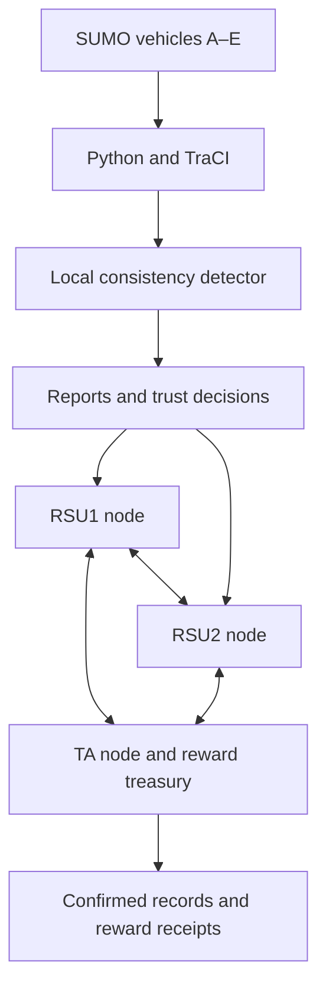

# Blockchain-Based Adaptive Trust Management

A Windows lab prototype of vehicle trust management using **MultiChain, Python and Eclipse SUMO**. Five vehicle clients (A–E) interact through two roadside-unit nodes (RSU1 and RSU2) and a trusted-authority node (TA) on one permissioned blockchain.

The project adapts the reporting, trust and reward workflow from *Blockchain-Based Adaptive Trust Management in Internet of Vehicles Using Smart Contract*. It adds a local speed-consistency detector: Python detects suspicious messages, while MultiChain records evidence, reports, decisions and reward transactions.

> This is an educational adaptation, not the authors' original implementation. The original work uses Ethereum smart contracts. This project runs its trust logic in Python; MultiChain stores the records and enforces blockchain permissions.

## Architecture



All three nodes belong to **one chain named `iovlab`**. They are separate node processes on the same Windows machine, not three independent blockchains. Vehicle identities are addresses held in the RSU wallets rather than separate full nodes.

| Node | Data directory | Peer port | RPC port |
|---|---|---:|---:|
| TA | `%USERPROFILE%\iov-lab\TA` | 17400 | 17401 |
| RSU1 | `%USERPROFILE%\iov-lab\RSU1` | 17402 | 17403 |
| RSU2 | `%USERPROFILE%\iov-lab\RSU2` | 17404 | 17405 |

## Project files

| File or folder | Purpose |
|---|---|
| `connection.py` | Connects to the three nodes and checks vehicle registration and the reward balance. |
| `workflow.py` | Executes the manual reporting, decision and reward workflow. |
| `simulation.py` | Runs the SUMO/TraCI experiment and blockchain workflow; saves results. |
| `verify.py` | Audits stream records across the three nodes and checks the treasury balance. |
| `app.py` | Additional project file; not required by the demonstrated four-script command sequence below. |
| `simulation/demo.sumocfg` | SUMO simulation configuration. |
| `simulation/cars.rou.xml` | Vehicle routes. |
| `simulation/road.net.xml` | SUMO road network. |
| `simulation/road.nod.xml`, `road.edg.xml` | Source road definitions. |
| `simulation/sumo-*.csv`, `sumo-*.json` | Saved experiment outputs. |
| `Reports/` | Submission report and paper summary, when included in the repository. |

Local node folders `TA/`, `RSU1/` and `RSU2/` are runtime data. They contain wallets, configuration and databases and should not be distributed as installation files.

## Requirements

The recorded experiment used:

- Windows 10 and Windows Command Prompt (CMD).
- MultiChain Community 2.3.3.
- Python 3.12.0.
- Eclipse SUMO 1.28.0, including `sumo-gui` and network-generation tools.
- Python packages `requests`, `traci==1.28.0` and `sumolib==1.28.0`.
- Git for cloning the repository.

Install MultiChain and SUMO separately and add their executable directories to Windows `PATH`. The Python packages alone do not install the complete SUMO desktop application.

Check the tools in CMD:

```bat
py --version
multichain-util
sumo --version
netgenerate --version
```

Install and check the Python packages:

```bat
py -m pip install requests traci==1.28.0 sumolib==1.28.0
py -c "import requests, traci, sumolib; print('Python packages OK')"
```

## Get the repository

On a new machine, run the following in CMD. Do not clone over an existing working `iov-lab` folder.

```bat
cd /d "%USERPROFILE%"
git clone https://github.com/DotKhalid/Blockchain-Based-Adaptive-Trust-Management.git iov-lab
cd /d "%USERPROFILE%\iov-lab"
```

There are two ways to demonstrate the project:

1. **SUMO mobility replay:** open the supplied road and vehicle scenario without blockchain setup.
2. **Full trust-management experiment:** prepare the three-node chain, then run the Python workflow.

## Option 1: Replay vehicle movement in SUMO

From the repository folder:

```bat
sumo-gui -c simulation\demo.sumocfg --delay 100
```

Press **Play** in SUMO. Zoom into the road and use Pause or single-step controls to inspect vehicles. Alternatively, select **File → Open Simulation** and open `simulation/demo.sumocfg`.

This displays the vehicle movement only. Opening the configuration directly does not execute Python's attack injection, trust updates, reward payments or blockchain writes.

## Option 2: Run the full blockchain experiment

### A. First-time blockchain preparation

Cloning the source does not create wallets, permissions, registrations or assets. Complete the setup below before running `connection.py`. The detailed commands and configuration explanations are provided in the submission report under `Reports/`, if that folder is included.

1. Create the TA data directory and chain:

   ```bat
   mkdir "%USERPROFILE%\iov-lab\TA"
   multichain-util create iovlab -datadir="%USERPROFILE%\iov-lab\TA"
   ```

2. Before the first node start, review `TA\iovlab\params.dat`. The lab uses a permissioned chain, a restricted root stream and a short target block time. The documented lab settings include `root-stream-open=false`, `target-block-time=2`, `mining-diversity=0.3` and `setup-first-blocks=60`. Keep public connect/send/receive/create/issue/mine/admin permissions disabled. Do not edit genesis parameters on an already-running chain.
3. Start TA using the command in section B below.
4. Create `RSU1` and `RSU2` data directories. Join each node to `iovlab@127.0.0.1:17400`, using its own data directory and ports. On the first connection, MultiChain prints a newly generated address that requires authorization.
5. From TA, grant each printed RSU address `connect,send,receive,mine`, then restart that RSU with the same join command.
6. Generate three vehicle addresses on RSU1 for A, B and C, and two on RSU2 for D and E. Grant each vehicle `send,receive`.
7. Create the six restricted streams listed below and subscribe to them on all three nodes.
8. Grant vehicles write access to `reports` and `requests`. Grant the RSU identities write access to `decisions` and `telemetry`. TA publishes registrations and reward receipts.
9. Register A–E in `registry`, with each vehicle's generated address, `initial_trust: 10`, `initial_credits: 100` and `status: "active"`.
10. Issue `IOVREWARD` to the TA address: quantity `10000`, smallest unit `1`. Subscribe to the asset on all nodes.
11. Check the existing scripts' node paths, addresses and RPC settings against your new installation. **New wallets generate different addresses: original-run addresses cannot simply be reused.** Use your own locally generated RPC credentials; do not publish them.

This is a manual lab setup, not a one-command deployment. A fresh machine needs its own identity configuration before the complete workflow can run. The source is kept as the original lab implementation; this README does not change it or claim that a clean-machine installation has been tested.

### B. Start or restart the prepared nodes

Run these in CMD with MultiChain available on `PATH`. For an existing setup, start each node only if it is not already running.

```bat
multichaind iovlab -datadir="%USERPROFILE%\iov-lab\TA" -port=17400 -rpcport=17401 -daemon
multichaind iovlab@127.0.0.1:17400 -datadir="%USERPROFILE%\iov-lab\RSU1" -port=17402 -rpcport=17403 -daemon
multichaind iovlab@127.0.0.1:17400 -datadir="%USERPROFILE%\iov-lab\RSU2" -port=17404 -rpcport=17405 -daemon
```

Check that all three nodes respond:

```bat
multichain-cli iovlab -datadir="%USERPROFILE%\iov-lab\TA" -rpcport=17401 getinfo
multichain-cli iovlab -datadir="%USERPROFILE%\iov-lab\RSU1" -rpcport=17403 getinfo
multichain-cli iovlab -datadir="%USERPROFILE%\iov-lab\RSU2" -rpcport=17405 getinfo
```

### C. Check the setup

```bat
cd /d "%USERPROFILE%\iov-lab"
py connection.py
```

The recorded successful check showed all three nodes connected, vehicles A–E verified and `SETUP CHECK PASSED`. On a fresh, funded setup, the TA initially holds 10,000 IOVREWARD tokens.

### D. Execute the manual workflow

```bat
py workflow.py
```

This demonstrates reports from B–E, an RSU decision concerning A, reward requests and token payments. In the recorded manual session, A's trust decreased from 10 to 9; each reporter's trust increased from 10 to 11. B received 7 tokens and C, D and E received 5 each.

### E. Run the SUMO-integrated experiment

```bat
py simulation.py
```

Keep the nodes running. The Python program controls SUMO through TraCI, evaluates vehicle information and publishes blockchain records. Watch the terminal for the run identifier, detector events and session results.

In the demonstrated run, A supplied inconsistent speed information in two attack windows. Events at simulation seconds 16 and 81 were handled by RSU1 and RSU2 respectively. Each accepted session reduced A's trust and rewarded the reporting vehicles.

At the prompt:

```text
Simulation finished. Take a GUI screenshot now.
Press Enter here to close SUMO and save results...
```

Capture the GUI if needed, then press Enter in the terminal. Results are written under `simulation/` using the generated run identifier.

**Each new simulation execution creates another experiment and can change cumulative trust, stream counts and token balances.** It is not a read-only replay of the saved run.

### F. Verify the records

```bat
py verify.py
```

The recorded audit compared records across TA, RSU1 and RSU2 and confirmed them. The expected counts below belong to one manual session followed by one SUMO experiment. Extra runs change those totals and may no longer match fixed expectations in the verifier.

## Blockchain streams

| Stream | Stored information |
|---|---|
| `registry` | Vehicle identity and initial state. |
| `reports` | Signed vehicle reports. |
| `decisions` | RSU decisions and trust penalties. |
| `requests` | Vehicle reward requests. |
| `claims` | Reward receipts and reporter state increments. |
| `telemetry` | Selected evidence for detected events. |

`initial_credits=100` is an application bookkeeping value. It does not mean that each vehicle received 100 IOVREWARD tokens at registration.

## Recorded results

Reference experiment: `sumo-da33a5ddb2`. These figures include the preceding manual session.

| Vehicle | Final trust | Final credits | Reward tokens |
|---|---:|---:|---:|
| A | 7 | 100 | 0 |
| B | 13 | 121 | 21 |
| C | 13 | 115 | 15 |
| D | 13 | 115 | 15 |
| E | 13 | 115 | 15 |

TA retained **9,934 tokens**. Vehicles held **66 tokens** in total, reconciling to the original supply of 10,000.

| Stream | TA | RSU1 | RSU2 |
|---|---:|---:|---:|
| registry | 5 | 5 | 5 |
| reports | 12 | 12 | 12 |
| decisions | 3 | 3 | 3 |
| requests | 12 | 12 | 12 |
| claims | 12 | 12 | 12 |
| telemetry | 2 | 2 | 2 |

The audit reported matching, confirmed records on all nodes.

Detector counts were `TP=14`, `FP=0`, `TN=83`, `FN=2`: accuracy **97.98%**, precision **100%**, recall **87.50%** and F1 **93.33%**. These are 99 evaluated time samples for A in one deterministic scenario, not a real-world performance benchmark. The two decision sessions are different from the 14 positive detector samples.

## Inspect existing results without paying more rewards

Use `connection.py`, `verify.py` and read-only blockchain queries rather than rerunning the simulation:

```bat
multichain-cli iovlab -datadir="%USERPROFILE%\iov-lab\TA" -rpcport=17401 liststreamitems decisions
multichain-cli iovlab -datadir="%USERPROFILE%\iov-lab\TA" -rpcport=17401 liststreamitems claims
```

The default item listing may show only a subset on a larger ledger. The CSV and JSON files preserve the saved experiment results independently of a GUI replay.

## Stop the nodes

After closing the running Python/SUMO experiment:

```bat
multichain-cli iovlab -datadir="%USERPROFILE%\iov-lab\RSU1" -rpcport=17403 stop
multichain-cli iovlab -datadir="%USERPROFILE%\iov-lab\RSU2" -rpcport=17405 stop
multichain-cli iovlab -datadir="%USERPROFILE%\iov-lab\TA" -rpcport=17401 stop
```

## Troubleshooting

| Problem | Check |
|---|---|
| `sumo` or `multichain-cli` is not recognized | Add the installed executable directory to PATH and reopen CMD. |
| Python import error | Install the required packages with the same `py` interpreter used to run the scripts. |
| RPC connection failure | Confirm the node is running, the data directory is correct and the RPC port matches the node. |
| RPC authentication error | Check the node's local `multichain.conf` and the connection script's configuration. |
| Vehicle identity or registry check fails on a new PC | Use addresses generated by the new wallets and register/configure them consistently. |
| Permission denied during publishing | Check global send permission and the specific stream's write permission. |
| `Could not parse entity key` when subscribing | Subscribe to each stream separately rather than passing one comma-separated string. |
| `Entity with this name already exists` | The stream or asset already exists; do not issue/create it again. |
| SUMO vehicles move too quickly to inspect | Increase the GUI delay and pause while vehicles are visible. |
| Balances differ from the reference results | Check whether extra manual sessions or simulation runs were executed. |

## Scope and limitations

- SUMO models movement; this setup does not simulate a complete wireless V2X protocol stack.
- The speed-consistency detector executes in Python. MultiChain does not independently determine whether a physical observation is true.
- Temporary blocking is an application-level eligibility check. The recorded test did not revoke a MultiChain permission or submit a prohibited transaction to test network rejection.
- A ended with positive trust; permanent revocation was not demonstrated in the recorded experiment.
- All nodes and vehicle keys were operated on one laptop. This does not demonstrate independent infrastructure operators or production scalability.
- The project has not established robustness against sensor noise, colluding reporters or all attack types discussed in the paper.

## References

1. P. K. Singh et al., *Blockchain-Based Adaptive Trust Management in Internet of Vehicles Using Smart Contract*, IEEE Transactions on Intelligent Transportation Systems. DOI: [10.1109/TITS.2020.3004041](https://doi.org/10.1109/TITS.2020.3004041).
2. [Original smart-contract repository](https://github.com/kalikho/Trust-Management-ITS).
3. [MultiChain developer documentation](https://www.multichain.com/developers/).
4. [MultiChain JSON-RPC API](https://www.multichain.com/developers/json-rpc-api/).
5. [Eclipse SUMO documentation](https://sumo.dlr.de/docs/index.html).
6. [SUMO GUI instructions](https://sumo.dlr.de/docs/sumo-gui.html).
7. [TraCI documentation](https://sumo.dlr.de/docs/TraCI.html).
